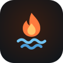
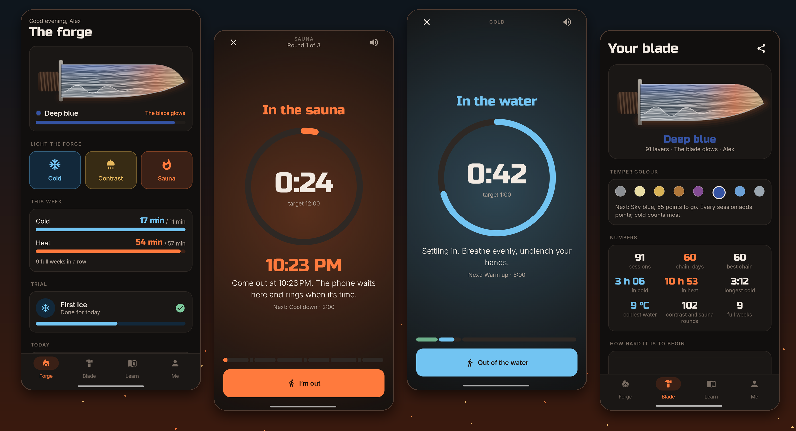
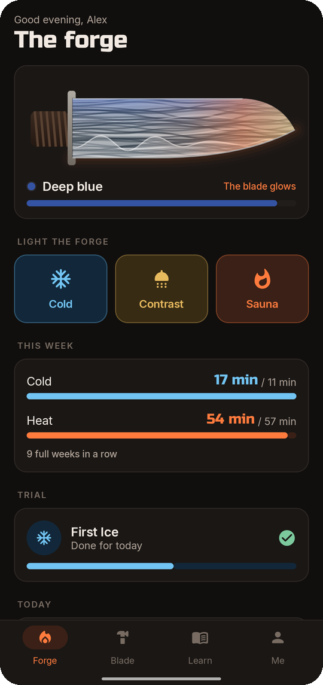
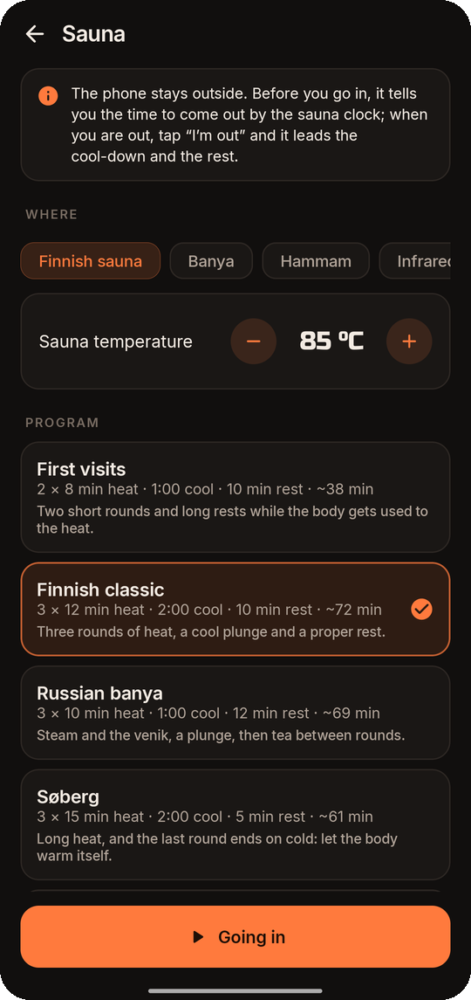
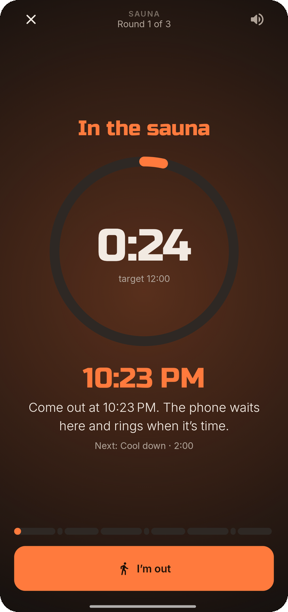
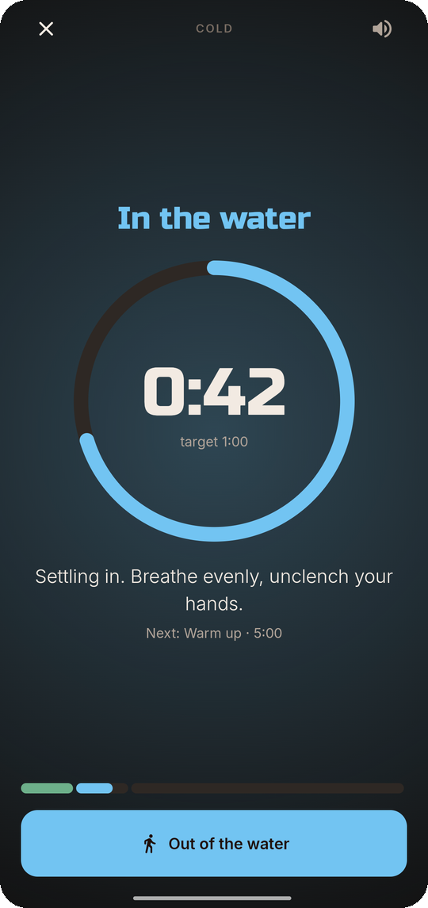
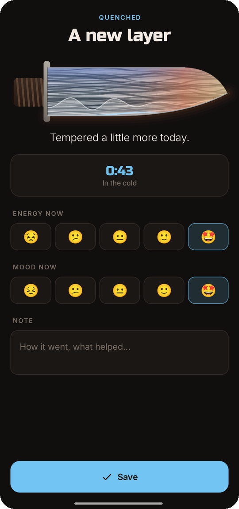
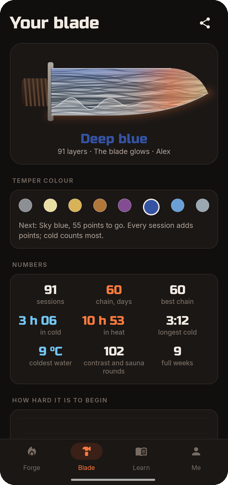
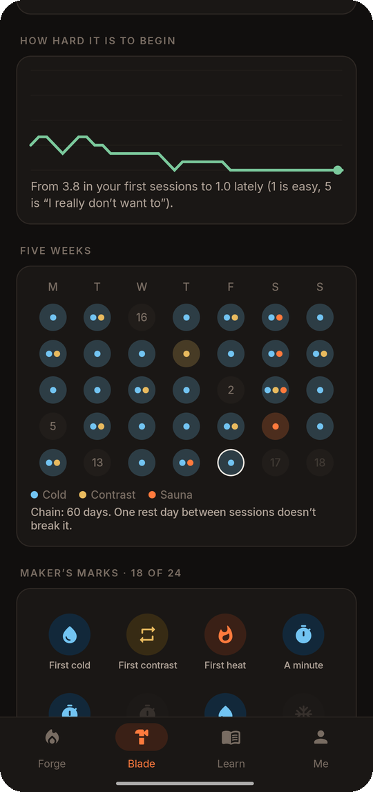
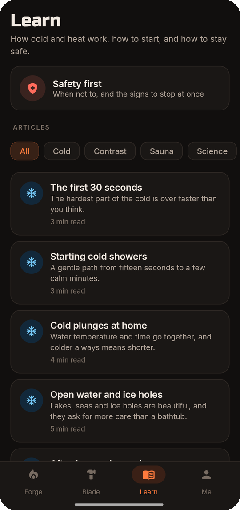

<div align="center">



# Temper

### Fire and water, like steel

*Cold showers, ice baths, open water, contrast showers and the sauna. Every session folds a new layer into your own Damascus blade. Free, no ads, no account, no internet access.*

[](https://github.com/bigdevwhale/temper/actions/workflows/android.yml)
[](https://github.com/bigdevwhale/temper/releases/latest)


[](LICENSE)

**English** · [Русский](README.ru.md) · [Website](https://bigdevwhale.github.io/stillcraft/apps/temper/) · [Changelog](CHANGELOG.md)



</div>

---

## The idea

A smith tempers steel with fire and water: heat it, quench it, again and again, until it holds an edge. You can temper yourself the same way.

Temper is a timer, a guide and a ledger for cold water, contrast showers and the sauna. Every session becomes a layer of your own Damascus blade. Practise and it glows; leave it and it cools and gathers frost.

## What's inside

| | Feature | How it works |
|---|---|---|
| ❄️ | **Cold** | A shower, a bath, open water or an ice hole. A minute of calm breathing on land, a target time, a voice through the shock, the settling and the calm, a cautious limit by water temperature, then five minutes of warming up on your own. |
| 🚿 | **Contrast** | Leave the phone outside the shower: a voice and tones say “hot” and “cold”. Five programs from Gentle start to Steel, or your own. The last round ends on cold. |
| 🔥 | **Sauna and banya** | The phone can't come in, so it doesn't have to. Before you go in it tells you the clock time to come out and rings every minute after it. Tap **I'm out** and it leads the plunge and the rest. Finnish, banya, hammam, infrared; Søberg's “end on cold”. |
| 🗡️ | **Your blade** | Each session folds a layer: cold ones dark, hot ones bright. The hamon deepens with your chain, the spine takes on the eight temper colours from raw iron to steel grey, and you can share it as a picture. |
| 📅 | **Weekly goal** | 11 minutes of cold and 57 of heat a week after Søberg's 2021 study, a gentler goal, or your own. A chain of practice days that one rest day doesn't break. |
| 😨 | **Fear line** | “How much do you not want to?” before each session, from 1 to 5. Watch the line fall over the weeks. Energy and mood after, by kind and time of day. |
| 🏅 | **Marks and trials** | 24 maker's marks and five trials: First Ice (30 sessions from 15 seconds to 3 minutes), Dawn, Contrast fortnight, Eight saunas, Wild water. Trials count sessions, so a missed day never breaks them. |
| 📖 | **Learn** | 12 articles: the first 30 seconds, starting cold showers, plunges, open water, afterdrop, contrast, sauna rounds, the banya, the Søberg principle, what the science says, breathing, safety. |
| 📜 | **Ledger** | Every session with temperatures, places and notes; add or fix one by hand. A daily reminder that stays quiet on days you've practised, a home-screen widget and a JSON backup. |

<table>
  <tr>
    <td></td>
    <td></td>
    <td></td>
    <td></td>
  </tr>
  <tr>
    <td></td>
    <td></td>
    <td></td>
    <td></td>
  </tr>
</table>

## Safety

Cold water and heat are real strain on the heart and circulation. Temper is not medical advice. If you have heart disease, high or low blood pressure, an arrhythmia, Raynaud's or epilepsy, are pregnant or unwell, ask a doctor first. Never go into open water alone, never hold your breath in water, and get out at once if you feel chest pain, dizziness, confusion or numbness. The app's time limits are cautious guides, not a promise of safety.

## Download

Get **Temper.apk** from the [latest release](https://github.com/bigdevwhale/temper/releases/latest) and open it on your phone (allow installing from your browser or file manager when asked). Android 8.0 or newer.

The voice uses your phone's text-to-speech. If it's silent, install a voice for your language in the system settings. Some phones (Xiaomi, Huawei, Samsung) stop apps in the background: allow autostart and lift battery restrictions for Temper so a session keeps running with the screen off.

## Privacy

No account, no ads, no analytics, and no internet permission at all. Everything stays on the phone unless you export a backup.

## Build

```bash
git clone https://github.com/bigdevwhale/temper.git
cd temper
./gradlew testDebugUnitTest     # unit tests
./gradlew assembleDebug         # debug APK (app.temper.dev)
./gradlew installDebug -Pdemo   # app.temper.demo with ten weeks of made-up sessions
```

Kotlin, Jetpack Compose, Room and DataStore. Releases are built and signed by GitHub Actions when a `v*` tag is pushed.

## License

[MIT](LICENSE). Part of [Stillcraft](https://bigdevwhale.github.io/stillcraft/), small tools for a quieter mind.
