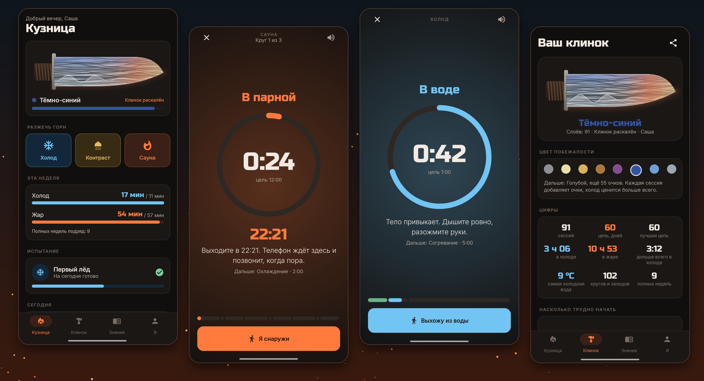
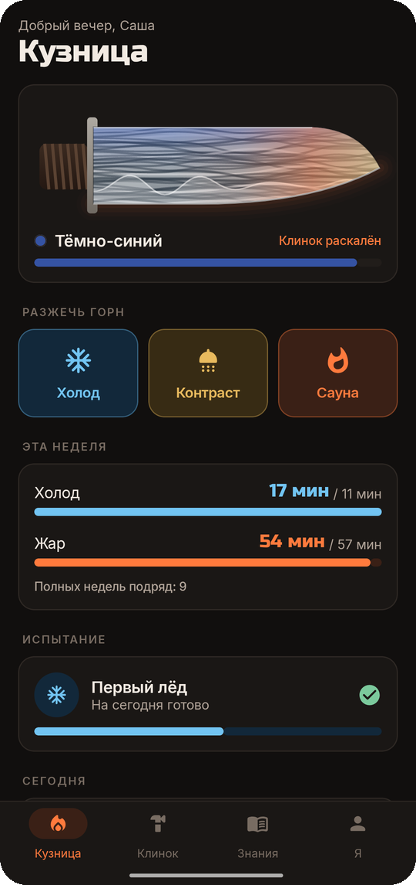
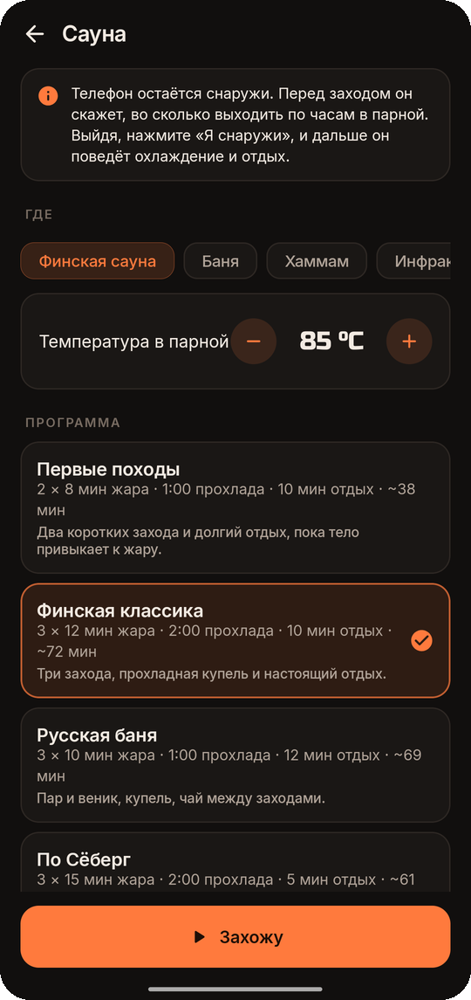
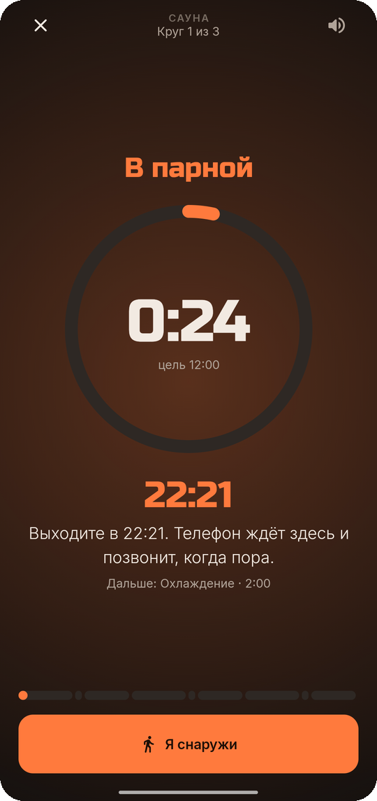
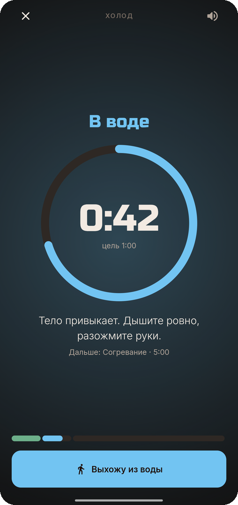
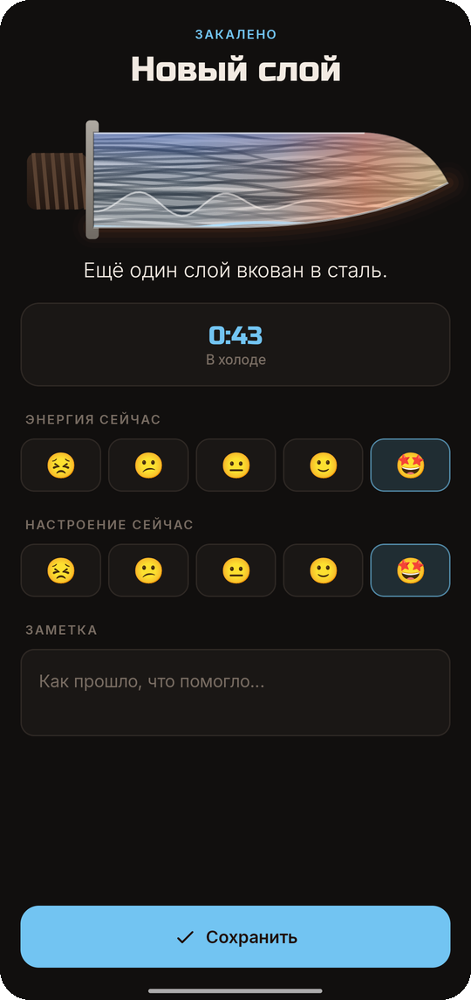
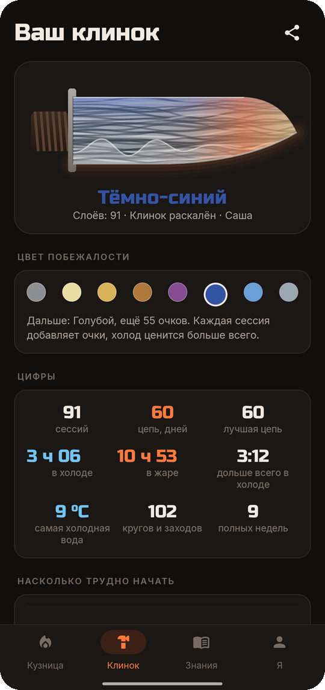
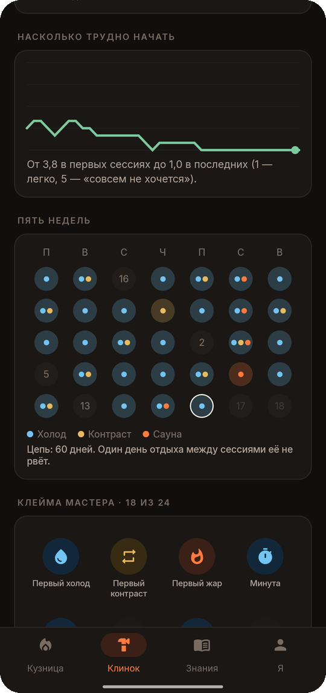
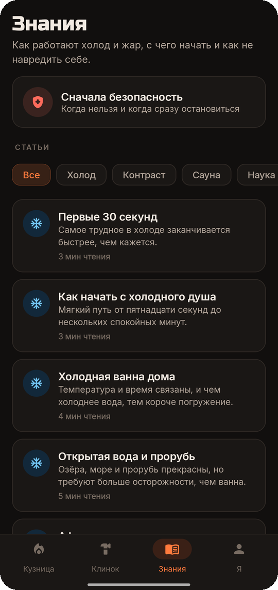

<div align="center">


# Temper

### Огонь и вода, как для стали

*Холодный душ, ледяная ванна, открытая вода, контрастный душ и сауна. Каждая сессия вковывает новый слой в ваш собственный дамасский клинок. Бесплатно, без рекламы, без аккаунта и без доступа в интернет.*

[](https://github.com/bigdevwhale/temper/actions/workflows/android.yml)
[](https://github.com/bigdevwhale/temper/releases/latest)


[](LICENSE)

[English](README.md) · **Русский** · [Сайт](https://bigdevwhale.github.io/stillcraft/apps/temper/) · [Изменения](CHANGELOG.md)



</div>

---

## Идея

Кузнец закаляет сталь огнём и водой: нагреть, охладить, снова и снова, пока она не начнёт держать заточку. Себя можно закалять так же.

Temper — таймер, проводник и журнал для холодной воды, контрастного душа и сауны. Каждая сессия становится слоем вашего собственного дамасского клинка. Занимаетесь — он раскалён; забросите — остынет и покроется инеем.

## Что внутри

| | Функция | Как работает |
|---|---|---|
| ❄️ | **Холод** | Душ, ванна, открытая вода или прорубь. Минута спокойного дыхания на суше, цель по времени, голос через шок, привыкание и спокойствие, осторожный предел по температуре воды и пять минут согревания без горячего душа. |
| 🚿 | **Контраст** | Телефон остаётся за шторкой: голос и сигналы говорят «горячая» и «холодная». Пять программ от «Мягкого старта» до «Стали» или своя. Последний круг заканчивается холодом. |
| 🔥 | **Сауна и баня** | Телефон в парную не возьмёшь, и не нужно. Перед заходом он скажет, во сколько выходить по часам, и будет звонить каждую минуту после. Нажмите **«Я снаружи»**, и он поведёт купель и отдых. Финская, баня, хаммам, инфракрасная; «финал холодом» по Сёберг. |
| 🗡️ | **Ваш клинок** | Каждая сессия — слой: холодные тёмные, горячие светлые. Хамон глубже с длиной цепи, обух проходит восемь цветов побежалости от сырого железа до стального серого, клинком можно поделиться картинкой. |
| 📅 | **Недельная цель** | 11 минут холода и 57 минут жара в неделю по исследованию Сёберг 2021 года, мягкий вариант или свой. Цепь дней практики, которую не рвёт один день отдыха. |
| 😨 | **Линия страха** | «Насколько не хочется?» перед каждой сессией, от 1 до 5. Через несколько недель видно, как линия падает. Энергия и настроение после, по видам и времени суток. |
| 🏅 | **Клейма и испытания** | 24 клейма мастера и пять испытаний: «Первый лёд» (30 сессий от 15 секунд до 3 минут), «Рассвет», «Две недели контраста», «Восемь саун», «Живая вода». Испытания считают сессии, поэтому пропуск их не ломает. |
| 📖 | **Знания** | 12 статей: первые 30 секунд, как начать холодный душ, купели, открытая вода, согревание после, контраст, заходы в сауну, баня, принцип Сёберг, что говорит наука, дыхание, безопасность. |
| 📜 | **Журнал** | Все сессии с температурами, местами и заметками; любую можно добавить или поправить вручную. Ежедневное напоминание, которое молчит в дни практики, виджет и резервная копия в JSON. |

<table>
  <tr>
    <td></td>
    <td></td>
    <td></td>
    <td></td>
  </tr>
  <tr>
    <td></td>
    <td></td>
    <td></td>
    <td></td>
  </tr>
</table>

## Безопасность

Холодная вода и жар — серьёзная нагрузка на сердце и сосуды. Temper не заменяет совет врача. Если у вас болезни сердца, высокое или низкое давление, аритмия, синдром Рейно, эпилепсия, беременность или вы нездоровы, сначала посоветуйтесь с врачом. Никогда не заходите в открытую воду в одиночку, не задерживайте дыхание в воде и сразу выходите при боли в груди, головокружении, спутанности или онемении. Пределы времени в приложении — осторожные ориентиры, а не гарантия безопасности.

## Скачать

Скачайте **Temper.apk** из [последнего релиза](https://github.com/bigdevwhale/temper/releases/latest) и откройте его на телефоне (разрешите установку из браузера или файлового менеджера). Нужен Android 8.0 или новее.

Голос — это синтез речи вашего телефона. Если он молчит, установите голос для своего языка в настройках системы. Некоторые телефоны (Xiaomi, Huawei, Samsung) останавливают приложения в фоне: разрешите Temper автозапуск и снимите ограничения батареи, чтобы сессия шла при выключенном экране.

## Приватность

Без аккаунта, рекламы и аналитики, вообще без разрешения на интернет. Всё хранится на телефоне, пока вы сами не выгрузите резервную копию.

## Сборка

```bash
git clone https://github.com/bigdevwhale/temper.git
cd temper
./gradlew testDebugUnitTest     # юнит-тесты
./gradlew assembleDebug         # отладочный APK (app.temper.dev)
./gradlew installDebug -Pdemo   # app.temper.demo с десятью неделями выдуманных сессий
```

Kotlin, Jetpack Compose, Room и DataStore. Релизы собирает и подписывает GitHub Actions при пуше тега `v*`.

## Лицензия

[MIT](LICENSE). Часть [Stillcraft](https://bigdevwhale.github.io/stillcraft/) — маленьких инструментов для спокойного ума.
